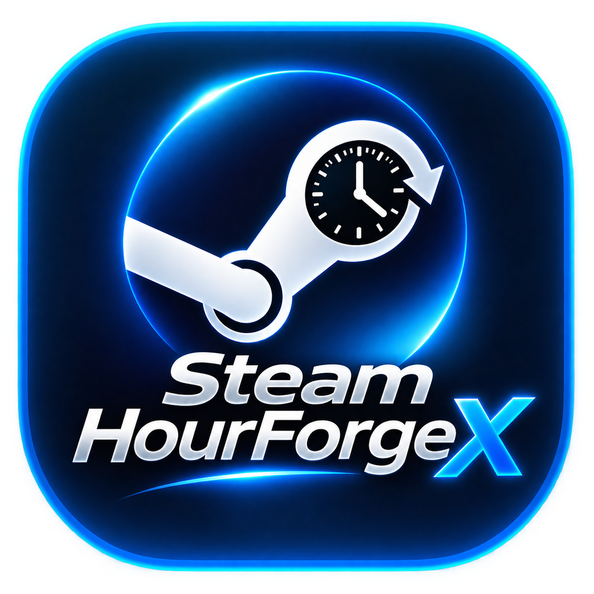

<p align="center"></p>

# Steam HourForge X

**Manage Steam playtime, card-drop queues and multiple accounts from a local dashboard.**

English · [Türkçe](README.tr.md)

[](https://github.com/ykasapoglu06-bit/Steam-HourForge-X/actions/workflows/ci.yml)
[](https://github.com/ykasapoglu06-bit/Steam-HourForge-X/releases/latest)
[](LICENSE)
[](README.tr.md)

[Download the latest source release](https://github.com/ykasapoglu06-bit/Steam-HourForge-X/releases/latest) · [Report a bug](https://github.com/ykasapoglu06-bit/Steam-HourForge-X/issues/new/choose) · [Request a feature](https://github.com/ykasapoglu06-bit/Steam-HourForge-X/issues/new/choose)

Choose the games you want to prioritize, see what is being reported to Steam and follow the next group in the queue. Use the cards-first mode to run games with remaining eligible drops before returning to your playtime priorities. The interface supports English and Turkish.

## What you can do

| Feature | Behavior |
| --- | --- |
| Playtime priorities | Keep starred games in each group while other games rotate through available slots. |
| Cards first | Run one eligible card game at a time; return to the hours queue when no drops remain. |
| Multiple accounts | Use separate sign-ins, saved sessions, libraries and settings for up to 20 local account entries. |
| Password or QR sign-in | Sign in with your Steam account name and password, or use a QR code. Handle Steam verification when requested. |
| Library and discovery | Load your library, look up public profiles and add a missing title by App ID or Steam store link. |
| Queue visibility | See the active group, the next group and the full execution order. Expand game lists when you need them. |
| Achievement editor | Read progress and select missing achievements for an explicitly confirmed Windows SAM operation. |
| Profile shortcuts | Show Steam avatars, SteamID64, Steam2 ID and vanity paths; open Steam and five account-service sites. |
| Local preferences | Remember account labels, priorities, rotation periods and language selection. |

## Get started on Windows

The release download is a **source package**, not a standalone installer or bundled Node.js runtime.

1. Install **Node.js 22.13 or newer** and download the ZIP asset from [Releases](https://github.com/ykasapoglu06-bit/Steam-HourForge-X/releases/latest).
2. Extract it to a folder you can write to. Open `start.bat`.
3. The launcher installs dependencies when needed, builds the app and creates branded shortcuts in the folder and on your desktop.
4. Open **http://127.0.0.1:17321**, add an account if needed and sign in.
5. In **Library**, star your priority games. Choose **Hours first** or **Cards first** on the activity page.

Windows builds also need the .NET Framework C# compiler for the x86 achievement bridge. Later launches can use the branded shortcut. Closing the browser page leaves the background process running. To use updated backend code, restart the application's background process as well as the page.

### Start from a Git checkout

```sh
git clone https://github.com/ykasapoglu06-bit/Steam-HourForge-X.git
cd Steam-HourForge-X
npm ci
npm test
npm run build
npm start
```

A personal `.env` or `config.json` is not needed for the first launch. Use `config.example.json` as a reference for manual configuration.

## Sign-in and saved accounts

Use the actual **Steam account name**, which can differ from the public profile name. Accounts without Steam Guard can sign in with their password alone. If Steam requests an email code, authenticator code or approval, complete that step in the dashboard or Steam app. QR sign-in is an alternative.

Passwords entered in the dashboard are used for that attempt and are not saved to configuration or browser storage. A refresh token is saved locally for reconnecting. Credentials entered manually in a configuration file remain your responsibility.

| Action | What happens |
| --- | --- |
| Pause / Resume | Change farming for that account. The latest choice is kept across an achievement operation. |
| Disconnect | Stop that account's activity and keep its saved sign-in. |
| Sign out | Disconnect and clear its saved sign-in and configured credentials. Sign in again with password or QR. |
| Remove from app | Confirm removal of its local entry, preferences and saved sign-in. Your Steam account and library are unaffected. |

You can remove the last entry and add a new one later. Conflicting account actions are disabled during native achievement processing. Duplicate active identities are checked before a new resolved Steam login proceeds.

## Playtime and card queues

**Hours first** builds groups of up to 32 games. Priority games occupy a slot in every group; other titles rotate through the remaining slots. If you pin all 32 slots, other games have no room. Set the group duration from **5 to 240 minutes** in account settings.

**Cards first** runs one game with remaining eligible drops, temporarily putting the hours priorities on hold. Badge pages are checked every five minutes. The dashboard shows the current eligible game, remaining rights and the next game. Once rights run out, the hours queue resumes with your priorities. A badge-counter decrease is an observation; drop eligibility and timing are decided by Steam.

The reported state means the app sent a playing state to Steam. It does not independently verify credited hours. Refresh the library to update recorded playtime. Adding an App ID checks the Steam title; it does not grant ownership or guarantee playtime credit.

## Achievement operations on Windows

1. Keep the Steam desktop client online with the **same account** selected in the dashboard. Stop games running in other sessions.
2. Check progress or open the achievement selection for an owned game. Native access can work even when public community stats are unreadable.
3. Review the actual missing achievements and select the ones you want to change.
4. Confirm the account, game and selection. The preview token is single-use and expires after two minutes.
5. Review the result, verified by a separate native read. If submission times out or its outcome is unknown, recheck before retrying.

Farming disconnects temporarily for the native handoff, then reconnects using the saved session. Your latest pause/resume choice is preserved. Checking progress or opening a preview does not write achievements. Completion attempts are logged in `data/achievement-actions.jsonl`.

Server-controlled or protected achievements may reject changes. Steam controls account rules, credited hours and drops; results and account safety are not guaranteed. The app does not modify game files, numeric player statistics or leaderboards.

## Profile links

Account cards show the signed-in persona and available identity details. **Steam profile** appears first, followed by **VacList, CSRep, CSStats, CSWatch and SteamIDCheck**. Each link opens the selected public SteamID on that service. The app does not perform a combined ban/status scan or send saved login credentials to those services. See [icon sources](docs/LOGO_SOURCES.md).

## Platforms and requirements

| Platform | Dashboard, hours and cards | Native achievement editor |
| --- | --- | --- |
| Windows | Supported; Node.js 22.13+ | Requires desktop Steam and the .NET Framework C# compiler. |
| Linux | Supported; Node.js 22.13+ | Windows only; public progress reading may be available. |
| Docker / Linux | Compose example included; no live Docker validation recorded. | Not available. |

`docker compose up --build` publishes the dashboard on host loopback. The example persists `data/`; persist `config.json` separately if you need account entries and preferences across container recreation. Keep the dashboard private to your machine.

## Local data and privacy

| Location | Contents |
| --- | --- |
| `config.json` | Account entries and settings; may contain credentials if configured manually. |
| `data/tokens/` | Saved Steam refresh tokens. |
| `data/steam/` | Per-account Steam client cache. |
| `data/achievement-actions.jsonl` | Achievement completion attempts. |
| `data/steam-hourforge-x.log` | Desktop launcher output. |

The app has no analytics. Steam connections, artwork requests and external profile links still use the network. The local status endpoint omits passwords, shared secrets, cookies and refresh tokens, but contains account details and may contain a live QR challenge. Do not expose it publicly or share unredacted logs/screenshots. Read [SECURITY.md](SECURITY.md).

## Troubleshooting

| Symptom | Check |
| --- | --- |
| `npm` or Node.js not found | Install Node.js 22.13+ and reopen the terminal or launcher. |
| Native build fails | Check the Windows .NET Framework compiler requirement and the build output. |
| Sign-in asks for a code | Use the verification method Steam requests; a public profile name is not your login name. |
| Library or progress unavailable | Check profile privacy, account ownership and the Steam connection; retry the library scan. |
| No cards remaining | Hours rotation resumes; the app cannot create additional drop eligibility. |
| Achievement result rejected or unknown | Check the selected desktop account and game ownership; recheck progress before retrying. |
| Old version still appears | Restart the application's background process, then reload the dashboard. |

## Development and contributions

The backend uses TypeScript and the interface uses plain JavaScript/CSS. Windows and Linux builds run in [GitHub Actions](https://github.com/ykasapoglu06-bit/Steam-HourForge-X/actions/workflows/ci.yml). The v2.4.4 checks passed **80 tests**; see [release checks](docs/RELEASE_CHECKS.md) for scope and limitations.

Bug reports and feature requests are welcome in **English or Turkish**. Include the app version, operating system and reproduction steps. Never attach passwords, tokens, cookies, active QR codes or your private configuration. See [CONTRIBUTING.md](CONTRIBUTING.md) and [recent changes](docs/CHANGELOG.md).

Create a clean source package with:

```sh
npm run package:source -- /absolute/path/to/a/new-output-directory
```

It includes a SHA-256 source manifest and excludes local configuration, sessions, logs, dependencies and the optional private runtime. The bundled SAM.API library and its original license are included; the helper EXE is built from C# source.

## Project owner and license

**Yusuf Kasapoglu** · [GitHub](https://github.com/ykasapoglu06-bit) · [Steam: yuu55uuf](https://steamcommunity.com/id/yuu55uuf/)

MIT licensed, with the original Alden (realalden27) attribution preserved. SAM.API is by Rick (gibbed) and retains its original license. Steam, game artwork and service marks belong to their respective owners. Steam HourForge X is independent of Valve and Steam. Read [LICENSE](LICENSE) and [third-party notices](THIRD_PARTY_NOTICES.md).

If this project helps you, a GitHub star makes it easier to find again. Reproducible bug reports and documentation improvements are welcome.
